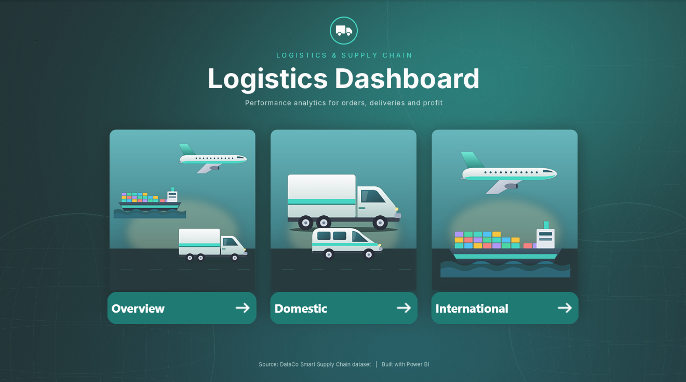
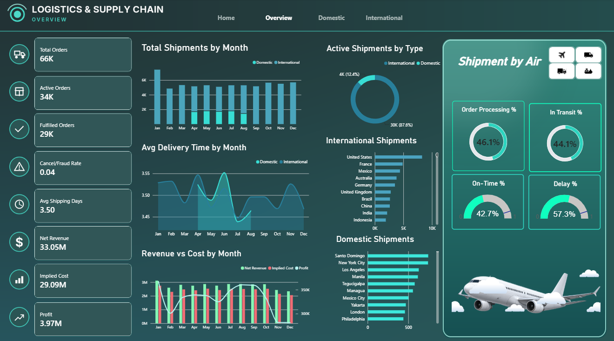
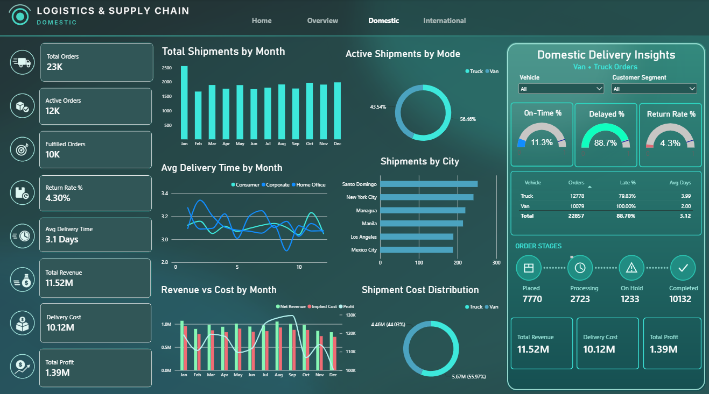
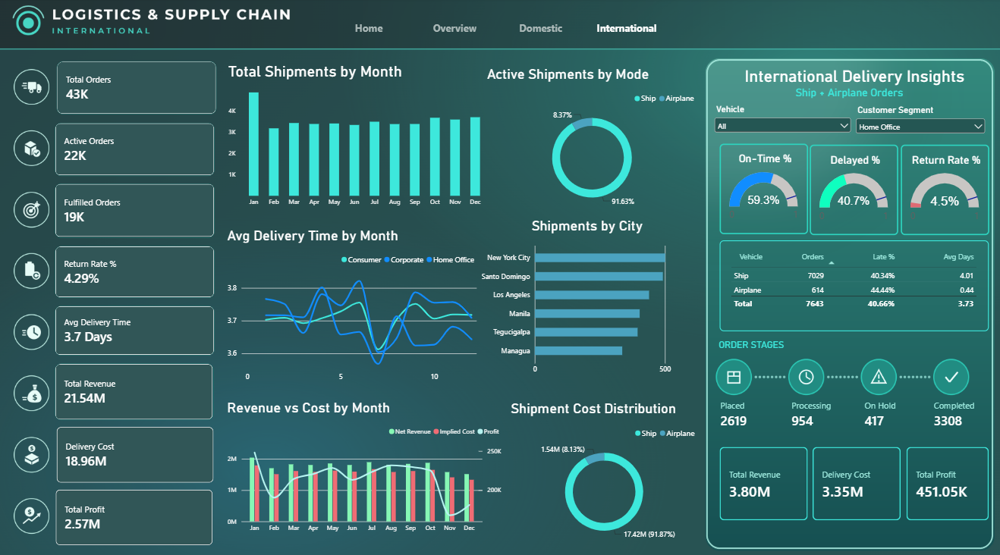

# 📦 Logistics & Supply Chain Performance Analytics Dashboard

An interactive **Power BI dashboard** designed to analyze delivery performance, shipping modes, sales, and profitability across a global supply chain using the DataCo Smart Supply Chain dataset.

## 📊 Dashboard Preview









---

## 📑 Table of Contents

- Project Overview
- Business Problem
- Dataset
- Tools & Technologies
- Data Cleaning
- Data Model
- Dashboard Pages
- Key Metrics (DAX Measures)
- Key Insights
- How to Access the Project
- Repository Structure
- Author

---

## 🚀 Project Overview

This project transforms raw supply chain data into an interactive, multi-page Power BI dashboard.

It helps logistics managers monitor shipment performance, compare domestic and international shipping modes, identify delivery delays, and understand sales and profitability trends.

The dashboard provides actionable insights into logistics operations through interactive visualizations, KPIs, slicers, and navigation buttons.

## 🎯 Business Problem

Late deliveries, inefficient shipping methods, and increasing transportation costs can affect customer satisfaction and overall business performance.

This dashboard addresses the following business questions:

- How efficiently are shipments delivered against scheduled delivery times?
- Which shipping modes experience the highest delivery delays?
- How do domestic and international shipping operations compare?
- Which regions and markets generate the highest sales?
- What are the major factors affecting delivery performance and profitability?

## 📂 Dataset

- **Dataset:** DataCo Smart Supply Chain Dataset
- **File:** `DataCoSupplyChainDataset.csv`
- **Coverage:** Orders, customers, products, shipping, delivery status, sales, and profit.
- **Source:** DataCo Supply Chain Dataset.

## 🛠️ Tools & Technologies

| Technology | Purpose |
|---|---|
| Power BI Desktop | Dashboard development and visualization |
| Power Query | Data cleaning and transformation |
| DAX | Measures and calculations |
| Excel / CSV | Dataset management |
| Data Modeling | Relationships and analytical structure |

## 🧹 Data Cleaning

Data preprocessing and transformation were performed using Power Query.

Key steps include:

- Removed duplicate records and irrelevant columns.
- Handled missing and null values.
- Standardized data types, including dates, numbers, and text.
- Corrected inconsistent column names and categories.
- Created derived fields for shipping delays and delivery status analysis.
- Prepared the dataset for effective data modeling and visualization.

## 🏗️ Data Model

The project uses a **Star Schema** approach, with a central fact table connected to multiple dimension tables.

| Table | Type | Description |
|---|---|---|
| Fact Orders | Fact | Sales, profit, shipping, and delivery information |
| Dim Customer | Dimension | Customer details and segments |
| Dim Product | Dimension | Product and category information |
| Dim Location | Dimension | Market, region, country, and city |
| Dim Date | Dimension | Calendar information for time-based analysis |
| Dim Shipping | Dimension | Shipping modes and delivery status |

*Note: Table names should match the actual data model in the Power BI file.*

## 📊 Dashboard Pages

The dashboard consists of **four interactive pages** with button-based navigation and a dark-teal theme.

### 1. Home Page
- Main landing page.
- Navigation cards for accessing different dashboard sections.
- Provides an overview of the report structure.

### 2. Overview Dashboard
- Overall business performance.
- Total sales and profit.
- Delivery status breakdown.
- Sales and profit trends.
- Important business KPIs.

### 3. Domestic Analysis
- Analysis of van and truck shipments.
- First Class and Second Class shipping modes.
- Delivery performance and shipment analysis.
- Sales and profitability comparisons.

### 4. International Analysis
- Analysis of plane and ship shipments.
- Same Day and Standard Class shipping modes.
- Delivery performance comparisons.
- Shipping and business performance analysis.

**Note:** Domestic and International categories in this project are defined by shipping modes, not by a US versus non-US geographical split.


## 📈 Key Metrics (DAX Measures)

The dashboard uses DAX measures to calculate important business performance indicators.

- Total Sales
- Total Profit
- Profit Margin %
- Total Orders
- Average Shipping Days
- On-Time Delivery %
- Late Delivery %
- Year-over-Year Growth

### Sample DAX Measure

**On-Time Delivery Percentage**

```DAX
On-Time Delivery % =
DIVIDE(
    CALCULATE(
        COUNTROWS('Fact Orders'),
        'Fact Orders'[Delivery Status] = "Shipping on time"
    ),
    COUNTROWS('Fact Orders')
)
```

## 💡 Key Insights

The dashboard helps identify:

- Delivery performance and shipment delays.
- Differences in performance across shipping modes.
- Sales and profitability trends.
- Regional and market-level business performance.
- Opportunities to improve logistics efficiency.


## 📥 How to Access the Project

The Power BI `.pbix` file is hosted on Google Drive because of GitHub's individual file upload size limitation.

### Download Power BI Dashboard

👉 **[Download Logistics & Supply Chain Dashboard (.pbix)](YOUR_GOOGLE_DRIVE_LINK)**

### Steps to Run

1. Download the `.pbix` file using the link above.
2. Install Power BI Desktop.
3. Open the downloaded Power BI project.
4. If required, update the dataset location through **Home → Transform Data → Data Source Settings**.
5. Refresh the dataset.
6. Explore the interactive dashboard.

## 📁 Repository Structure

```text
PowerBI-Logistics-Supply-Chain/
│
├── README.md
│
├── data/
│   └── DataCoSupplyChainDataset_cleaned.csv
│
└── screenshots/
    ├── home.png
    ├── overview.png
    ├── domestic.png
    └── international.png
```

## 👨‍💻 Author

**Sreyas T**

B.Tech Graduate in Artificial Intelligence and Data Science  
Jyothi Engineering College  
Thrissur, Kerala, India

